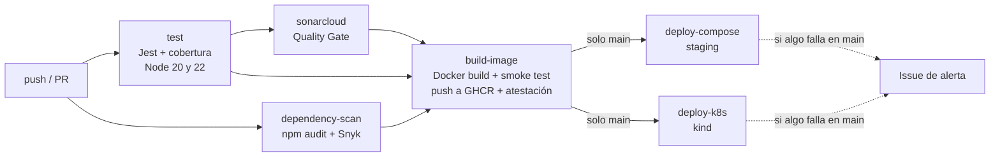

# NodeJs App — Pipeline CI/CD

Microservicio Node.js (Express) con cálculo de descuentos y validación de órdenes, con un pipeline CI/CD completo en **GitHub Actions**: pruebas, análisis de seguridad, contenedor Docker, despliegue automático en entorno simulado y orquestación (Docker Compose y Kubernetes).

> Evaluación Parcial N°2 — DOY0101 Ingeniería DevOps.
> Integrantes: _(completar nombres)_

## 1. Endpoints

| Método | Ruta                  | Descripción                                          |
|--------|-----------------------|------------------------------------------------------|
| GET    | `/health`             | Estado del servicio y `version` (SHA del commit)     |
| POST   | `/api/discount`       | Calcula descuento (`amount`, `tier`, `isFirstPurchase`, `couponCode`) |
| POST   | `/api/validate-order` | Valida una orden (`customerEmail`, `items[]`)        |

## 2. Arquitectura del pipeline



Archivo: [`.github/workflows/ci.yml`](.github/workflows/ci.yml)

| Job | Qué hace | Indicador |
|-----|----------|-----------|
| `test` | `npm ci` + `jest --coverage` en Node 20 y 22; falla si un test falla o la cobertura baja de los umbrales | IE2 |
| `dependency-scan` | `npm audit --audit-level=high` y Snyk (`--severity-threshold=high`). **Bloqueante** (sin `continue-on-error`) | IE3 |
| `sonarcloud` | Análisis estático + cobertura. `sonar.qualitygate.wait=true`: si el Quality Gate falla, falla el job | IE3 |
| `build-image` | Construye la imagen con `docker buildx`, la prueba (smoke test) y, en `main`, la publica en GHCR con tag = SHA del commit | IE1 |
| `deploy-compose` | Descarga la imagen por SHA, `docker compose up --wait`, smoke tests | IE4 |
| `deploy-k8s` | Crea un clúster `kind`, aplica `k8s/`, espera el rollout y prueba `/health` | IE4 / IE5 |
| `alert-on-failure` | Si algo falla en `main`, abre un Issue con enlace a la ejecución | IE3 |

Las pull requests ejecutan test, escaneos y build; el **despliegue solo ocurre en `main`**.

## 3. Contenedores (IE1)

- [`Dockerfile`](Dockerfile) multi-stage sobre `node:22-alpine` (imagen liviana), solo dependencias de producción (`npm ci --omit=dev`).
- Se ejecuta con usuario no-root (`USER node`), tiene `HEALTHCHECK` y `.dockerignore`.
- `ARG GIT_SHA` → `APP_VERSION`: el commit queda dentro de la imagen y se expone en `/health`.

```bash
docker build --build-arg GIT_SHA=$(git rev-parse HEAD) -t node-app:local .
docker run --rm -p 3000:3000 node-app:local
curl localhost:3000/health
```

## 4. Orquestación (IE5)

**Docker Compose** ([`docker-compose.yml`](docker-compose.yml)): healthcheck, `restart: unless-stopped`, límites de CPU/memoria, `read_only`, `cap_drop: ALL`, `no-new-privileges`.

```bash
docker compose up --build        # local
```

**Kubernetes** ([`k8s/`](k8s/)):
- `Deployment`: 2 réplicas, `RollingUpdate` con `maxUnavailable: 0` (sin caída), readiness/liveness probes sobre `/health`, `requests/limits`, `securityContext` (no-root, FS de solo lectura, sin capabilities).
- `Service` ClusterIP (80 → 3000).
- `HorizontalPodAutoscaler`: 2–5 réplicas al 70 % de CPU.

```bash
kubectl apply -f k8s/namespace.yaml && kubectl apply -f k8s/
kubectl -n nodejs-app set image deployment/nodejs-app app=<imagen>
```

> En `kind` no hay metrics-server, por lo que el HPA queda creado pero sin métricas; en un clúster real escala según CPU.

## 5. Seguridad y gobernanza (IE3)

- **Dependabot** ([`.github/dependabot.yml`](.github/dependabot.yml)): PRs semanales para npm, imagen base Docker y GitHub Actions.
- **Snyk + npm audit**: bloquean ante vulnerabilidades HIGH/CRITICAL.
- **SonarCloud** con Quality Gate bloqueante.
- **Alerta**: Issue automático cuando el pipeline falla en `main`.
- **Permisos mínimos** (`permissions: contents: read` por defecto, elevados solo por job).
- Contenedor no-root y endurecido.

### Configuración requerida en GitHub

1. **Secrets** (Settings → Secrets and variables → Actions): `SNYK_TOKEN`, `SONAR_TOKEN`.
2. En `sonar-project.properties` reemplazar `sonar.projectKey` y `sonar.organization` por los del equipo.
3. **Branch protection** sobre `main` (Settings → Branches): exigir PR y los status checks `test`, `dependency-scan`, `sonarcloud` y `build-image`. Así un fallo de seguridad **bloquea el merge**.
4. **Environment** `staging` (Settings → Environments): opcional, permite aprobaciones manuales antes de desplegar.
5. Settings → Actions → General → Workflow permissions: _Read and write_ (para crear Issues y publicar en GHCR).

## 6. Trazabilidad (IE4)

Cada cambio se puede seguir de punta a punta:

1. **Commit/PR** → dispara el pipeline (cada ejecución queda registrada en la pestaña *Actions*).
2. **Imagen** etiquetada con el SHA completo del commit y con labels OCI (origen, revisión) vía `docker/metadata-action`.
3. **Atestación de procedencia** (`attest-build-provenance`): certifica qué commit y workflow construyó la imagen.
4. **Despliegue**: Compose y Kubernetes usan la imagen por SHA (nunca `latest`); en K8s se anota `change-cause` con commit y run id.
5. **Verificación**: `/health` devuelve `version` = SHA; el smoke test comprueba que coincide con el commit que disparó el pipeline.

## 7. Calidad (IE2)

- 32 pruebas unitarias y de API (Jest + Supertest), cobertura ≈ 98 %.
- Quality gate en [`jest.config.js`](jest.config.js): mínimo 80 % global (90 % ramas / 95 % líneas en `discountCalculator.js`). Si baja, el job `test` falla.
- Reportes: JUnit y cobertura (lcov/HTML) como artefactos; comentario de cobertura en cada PR; SonarCloud analiza el mismo `lcov.info`.

```bash
npm ci
npm test            # tests + cobertura + quality gate
```

## 8. Estructura

```
src/                       código del microservicio
tests/                     pruebas (discountCalculator, orderValidator, app)
Dockerfile, .dockerignore  contenedor
docker-compose.yml         orquestación Compose
k8s/                       orquestación Kubernetes
.github/workflows/ci.yml   pipeline CI/CD
.github/dependabot.yml     actualización/escaneo de dependencias
sonar-project.properties   configuración SonarCloud
```

## 9. Declaración de uso de IA

_(Completar: indicar qué herramientas de IA se usaron y cómo se aplicaron, citando según https://bibliotecas.duoc.cl/ia)_

## 10. Conclusiones y reflexiones individuales

_(Cada integrante debe redactar aquí, sin apoyo de IA, su reflexión personal sobre su aprendizaje y contribución. La pauta prohíbe usar IA para esta sección.)_

**Integrante 1:**

**Integrante 2:**
